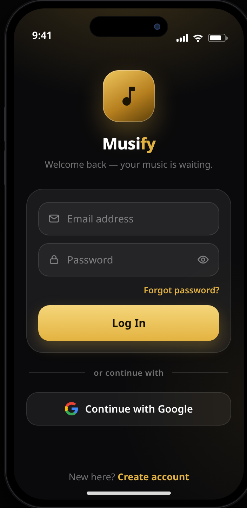
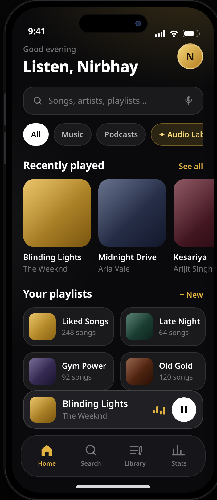
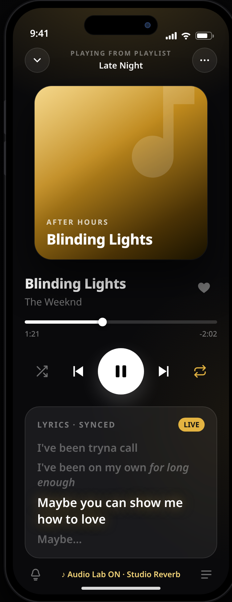
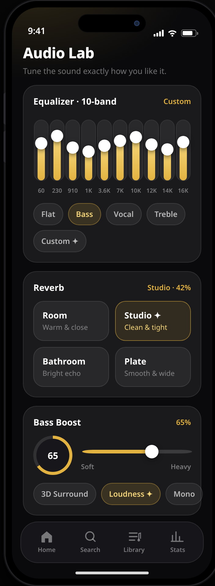

# Musify 🎵

**Musify** is a free Android music player with a premium black & gold look — no login needed to listen, no ads, no data collection.

## ⬇️ Download

**[👉 Download Musify APK (latest release)](https://github.com/nishusharmaa1221-arch/musify/releases/latest)**

- Size: ~36 MB
- Works on almost all Android phones (Android 7.0+)
- This is a direct APK file. While installing, if your phone shows a warning, tap **Install anyway / Allow** — the app is not on the Play Store yet.

## ✨ Features

- 🎧 Play your music with synced lyrics
- 🎚️ **Audio Lab** — 10-band equalizer, reverb and bass boost
- 📥 Import playlists from Spotify, Apple Music and YouTube Music
- 📊 Monthly listening stats
- 🔐 Simple login screen with a black-glass gold theme
- 🚫 No account needed for listening, no data collection

## 📱 Screens

| Login | Home |
|---|---|
|  |  |

| Now Playing | Audio Lab |
|---|---|
|  |  |

## 🙏 Credit

Musify is built on top of the open-source **Mochy Music** player (GPL-3.0) — thank you to its creators.
